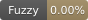
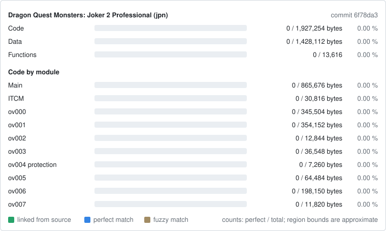

Dragon Quest Monsters: Joker 2 Professional (Nintendo DS)
=========================================================

> [!IMPORTANT]
> AI Disclosure:
> AI was used for the following tasks:
> - Writing commentary (primarily translating into English and formatting).
> - Documenting and citing the various sources used in the project (see PROVENANCE.md, REFERENCE.md, and more generally the files contained within the "notes" directory).
> - Writing code (C, C++, Python, etc.—I used it as a tool) and reviewing my own work (yes, some code was written by AI, but it was verified by a human; I didn't simply type "Claude, decompile this for me").

A work-in-progress matching decompilation of Dragon Quest Monsters: Joker 2
Professional for the Nintendo DS, built with
[ds-decomp](https://github.com/AetiasHax/ds-decomp). Sibling of
[dqmj2-decomp](https://github.com/YggdrasziI/dqmj2-decomp): code shared with Dragon
Quest Monsters: Joker 2 is ported from there.

> [!NOTE]
> No port to PC or other platforms is planned for the time being, but should that change, the link will appear here

This repository does **not** contain any game assets or assembly whatsoever. An existing
copy of the game is required.

It builds the following versions:

Name | Description       | SHA1 Hash of input ROM(s)
---- | ----------------- | ------------------------------------------
jpn  | Japan Revision 0 (`B2JJ`) | `602d6271c9993072cdcfb2d60958cb7b5f534b2a`

Professional was only released in Japan; `jpn` is the only version.

Progress
========

| Release | Game code | Progress |
|---|---|---|
| Dragon Quest Monsters: Joker 2 Professional (Japan) | `B2JJ` | [](notes/PROGRESS.md) [](notes/PROGRESS.md) [](notes/PROGRESS.md) |

[](notes/PROGRESS.md)

- **Fuzzy**: objdiff fuzzy match score over all code.
- **Perfect**: code that matches byte for byte.
- **Linked**: code built from source (`complete` files of `delinks.txt`).

The badges and the card are drawn from the objdiff report by
`tools/progress_badges.py`. After a build, `python tools/progress_badges.py --record`
redraws `progress/jpn/` and adds the current commit to `progress/jpn/history.csv`.

Dependencies
============

- [Python](https://www.python.org/downloads/) 3.10+ in `%PATH%`, then
  `pip install -r tools/requirements.txt`.
- [ninja](https://github.com/ninja-build/ninja/releases) in `%PATH%`
  (`pip install ninja` works too).
- On Windows use native tooling; WSL or msys2 are not required. On Linux,
  [wibo](https://github.com/decompals/wibo) is downloaded to run the compiler.

dsd, objdiff-cli and the mwccarm compilers are downloaded by the first `ninja` run.

Building
========

1. Copy the ROM to `extract/baserom_dqmj2p_jpn.nds`
   (SHA-1 `602d6271c9993072cdcfb2d60958cb7b5f534b2a`).
2. Optional: copy your own `arm7_bios.bin` to the repository root to check the
   original ROM SHA-1 (without it the secure area is not encrypted, see `SPEC.md`).
3. Run:

   ```
   python tools/configure.py
   ninja
   ```

   The first `ninja` only downloads the tools and reruns `configure.py`; run `ninja`
   again. A build ends with `build\jpn\dqmj2p_jpn.nds: OK`.

Diffing
=======

`ninja objdiff` writes `objdiff.json`; open the repository folder in
[objdiff](https://github.com/encounter/objdiff). `ninja report` writes
`build/jpn/report.json`.

Documentation
=============

- `SPEC.md`: target ROM, toolchain, acceptance criteria, naming.
- `notes/`: compiler evidence, region map, differences with DQMJ2
  (`DIFF_DQMJ2.md`), matching techniques, references and provenance of reused code,
  progress log.
